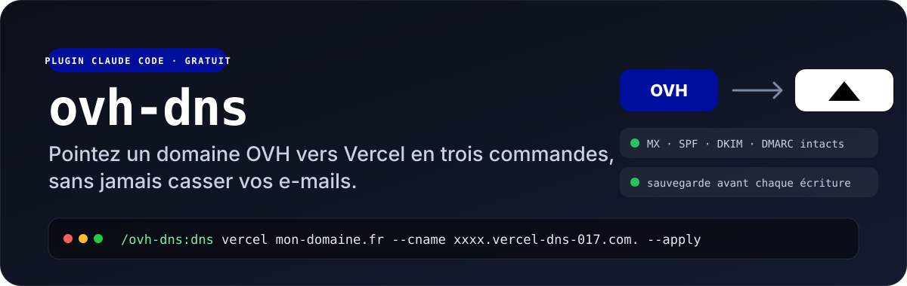

<p align="center">
  
</p>

<p align="center">
  <a href="#installation"></a>
  
  <a href="LICENSE"></a>
</p>

# ovh-dns

**Pointez un domaine OVH vers Vercel en trois commandes, sans jamais casser vos e-mails.**

Un plugin [Claude Code](https://claude.com/claude-code) qui pilote une zone DNS OVH par l'API officielle : lister, sauvegarder, nettoyer les enregistrements de bienvenue qui bloquent le CNAME, pointer vers Vercel, vérifier la propagation sur plusieurs résolveurs, auditer SPF, DKIM et DMARC.

Tous ceux qui ont un domaine chez OVH et un site chez Vercel ont vécu la même demi-heure : la page d'attente OVH qui empêche d'ajouter le CNAME `www`, le doute sur l'IP à mettre sur l'apex, la peur de supprimer le mauvais enregistrement et de couper le mail du client. Ce plugin la supprime.

```
/ovh-dns:dns list mon-domaine.fr
/ovh-dns:dns vercel mon-domaine.fr --cname xxxx.vercel-dns-017.com. --apply
/ovh-dns:dns check mon-domaine.fr
```

## Ce qu'il fait

| Commande | Effet |
|---|---|
| `list <domaine>` | La zone en tableau lisible. Les enregistrements mail sont marqués `[mail]`. |
| `backup <domaine>` | Sauvegarde JSON complète (enregistrements + export BIND) dans `~/.cache/ovh-dns/<domaine>/`. |
| `welcome <domaine> [--delete]` | Repère les enregistrements de la page d'attente OVH (A/AAAA `51.91.236.255`, TXT `1|www…`, `3|welcome`). Ne supprime qu'avec `--delete`. |
| `vercel <domaine> [--cname <cible>] [--apply]` | Affiche le plan : apex `A 216.198.79.1`, `www CNAME` vers la cible donnée par Vercel, suppression de ce qui bloque. N'écrit qu'avec `--apply`, puis rafraîchit la zone. |
| `set <domaine> <sous-domaine> <type> <cible>` | Crée ou met à jour un enregistrement. |
| `delete <domaine> <id>` | Supprime un enregistrement par identifiant. |
| `check <domaine>` | Interroge 1.1.1.1, 8.8.8.8 et les serveurs OVH, compare avec la zone, teste les codes HTTP de l'apex et de `www`. Dit « Propagé partout » quand c'est le cas. |
| `mail <domaine>` | État de MX, SPF, DKIM, DMARC et recommandations concrètes. |

## Trois garde-fous

1. **Sauvegarde automatique** avant toute écriture. Le chemin du fichier est toujours affiché.
2. **Plan avant action.** `vercel` et `welcome` montrent ce qu'ils vont faire. Rien n'est écrit sans `--apply` ou `--delete`, et l'agent demande votre accord avant.
3. **Le mail est intouchable.** MX, SRV, SPF, DKIM, DMARC, `autoconfig`, `autodiscover`, `imap`, `smtp`… ne sont jamais proposés à la suppression. `set` et `delete` les refusent sans `--force-mail`.

## Installation

```
/plugin marketplace add tbsrgt/claude-ovh-dns
/plugin install ovh-dns@tbsrgt
```

### Première utilisation

1. **Clé application OVH** (une fois) : créez-la sur [eu.api.ovh.com/createApp](https://eu.api.ovh.com/createApp/) et écrivez `~/.ovh.conf` :

   ```ini
   [default]
   endpoint=ovh-eu

   [ovh-eu]
   application_key=VOTRE_CLE
   application_secret=VOTRE_SECRET
   ```

   Les endpoints `ovh-ca` et `ovh-us` sont aussi reconnus.

2. **Clé consommateur par domaine** : limitée à la zone concernée, rien d'autre. À lancer vous-même dans Claude Code (préfixe `!`), puis ouvrir l'URL affichée et valider sur le compte OVH propriétaire du domaine :

   ```
   ! python3 ~/.claude/plugins/marketplaces/tbsrgt/scripts/request_ck.py mon-domaine.fr
   ```

   La clé est stockée dans `~/.cache/ovh-dns/mon-domaine.fr/ck` en lecture seule pour vous.

3. Dans Claude Code : `/ovh-dns:dns list mon-domaine.fr`.

Prérequis : Python 3.9 ou plus récent (bibliothèque standard uniquement), `dig`, `curl`.

## Pointer un nouveau domaine vers Vercel, de bout en bout

1. Côté Vercel, ajoutez le domaine au projet et notez la cible CNAME recommandée pour `www` (`xxxx.vercel-dns-017.com.`). Choisissez l'hôte principal : `www` recommandé, l'apex redirige.
2. `/ovh-dns:dns backup mon-domaine.fr` puis `list` : repérez les enregistrements mail à préserver.
3. `welcome mon-domaine.fr`, puis `welcome mon-domaine.fr --delete`.
4. `vercel mon-domaine.fr --cname xxxx.vercel-dns-017.com.`, lisez le plan, puis la même commande avec `--apply`.
5. `check mon-domaine.fr` toutes les cinq minutes jusqu'à « Propagé partout ». Le certificat Vercel se génère ensuite seul.
6. `mail mon-domaine.fr` et appliquez les recommandations SPF et DMARC si besoin.

## Sans Claude Code

Les scripts sont autonomes :

```bash
python3 scripts/ovh_dns.py list mon-domaine.fr
python3 scripts/ovh_dns.py vercel mon-domaine.fr --cname xxxx.vercel-dns-017.com. --apply
```

## English

**Point an OVH domain to Vercel in three commands, without ever breaking your email.**

A Claude Code plugin that drives an OVH DNS zone through the official API: list, back up, remove the OVH "welcome page" records that block the `www` CNAME, point to Vercel, verify propagation across several resolvers, audit SPF, DKIM and DMARC.

Three safeguards: an automatic backup before any write, a plan shown before anything is applied, and mail records (MX, SRV, SPF, DKIM, DMARC, autoconfig…) that are never touched without `--force-mail`.

```
/plugin marketplace add tbsrgt/claude-ovh-dns
/plugin install ovh-dns@tbsrgt
```

Setup: an OVH application key in `~/.ovh.conf` (see the INI example above, `ovh-eu`, `ovh-ca` and `ovh-us` endpoints supported), then one consumer key per domain via `scripts/request_ck.py <domain>`, scoped to that zone only. Python 3.9+, standard library only, plus `dig` and `curl`. Messages are in French.

## Licence

MIT. Fait à Aix-en-Provence par [Oculot Studio](https://oculot.studio). Si ce plugin vous a évité une demi-heure dans l'interface OVH, une étoile fait plaisir.
